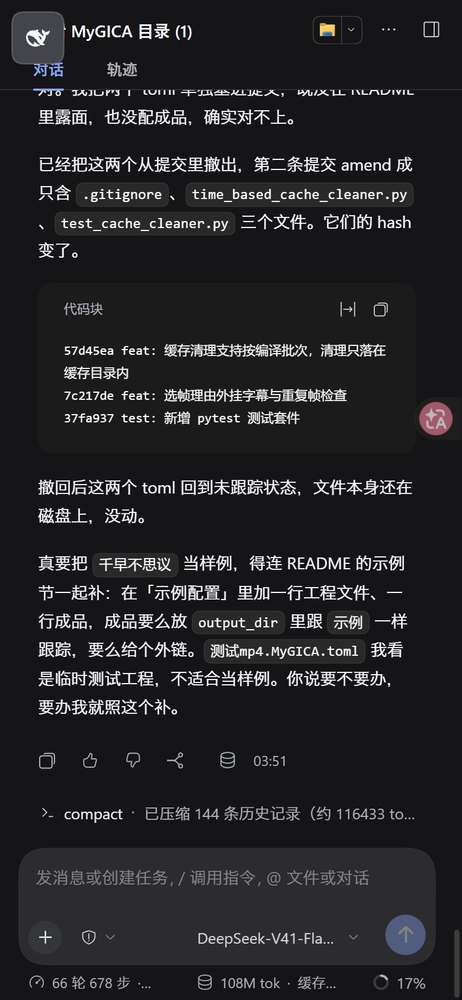
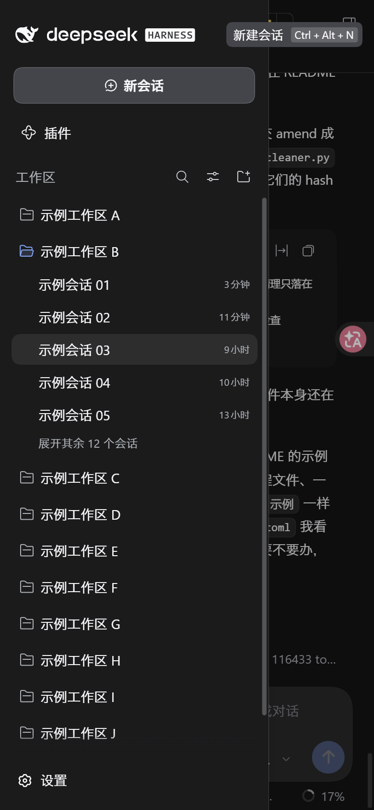

# DSH·手机适配

窄屏下把 DSH 改成手机形态：收起时为可拖动的悬浮方块，展开时为覆盖式抽屉，点会话自动收起，切换会话时压制自动聚焦，右上角提供一排手机键盘缺失的按键。

纯浏览器端插件，不改动原生界面与内置样式，仅在窄屏添加副作用。

## 引言

<!-- 本节由作者本人撰写，AI 不代笔。 -->
让 DSH 在手机浏览器里顺手一点。

## 功能

所有行为只在窄屏生效，视口宽度小于 1024 像素视为窄屏，宽屏下插件不介入。

取舍以阅读为先：手机上多数时间在浏览内容，软键盘弹出会占去半屏，因此收起态把宽度还给对话并压掉自动聚焦，用户主动点击输入框时立即撤销压制。

- 收起态：侧栏列压到零宽，中央区获得整幅宽度，左上角显示 44 像素悬浮方块，点击展开侧栏。
- 方块可拖动：拖到任意位置后松手吸附到最近的角或边，沿边位置按比例保留，停靠位本地保存，转屏后重新贴边。
- 展开态：侧栏变为 280 像素宽的覆盖式抽屉，压在对话之上，右侧有遮罩，点遮罩或侧栏内的收起按钮关闭。
- 点会话自动收起：点击任一会话行即收起，行内的更多按钮不触发。
- 压键盘：压制紧随会话点击的一次自动聚焦，持续一秒半；用户主动点击输入框立即撤销。
- 手机按键：右上角提供 Shift、Ctrl 与 Tab。Tab 在输入 / 或 @ 时交由补全菜单，否则插入制表符，终端中交由 shell 补全；Shift 与 Ctrl 为粘滞修饰键，点击锁定、再次点击取消，锁定时按回车分别为换行与排队发送。

## 截图

| 收起态 · 左上角悬浮小方块 | 展开态 · 覆盖式抽屉 |
| :---: | :---: |
|  |  |

展开态里的会话名与工作区名已替换为示例。

## 使用

用手机浏览器打开 DSH web，或将窗口缩至 1024 像素以下，即可看到收起态方块。点击展开抽屉，点击会话收起，右上角出现按键条。方块可拖到任意位置，松手吸附到最近的角或边；拖动结束的那一次松手不会触发展开。

已在 Xiaomi 14 上通过 mi14-webview 实测，1200×2670 屏幕正常触发，按键条的点击与高亮、Tab 的补全与插入、Shift 换行与 Ctrl 排队均已验证。

方块图标克隆内置收起栏的标记，跟随品牌变化；取不到图标时不显示方块，收起态的布局副作用一并跳过，侧栏保持内置形态。

## 安装

**从 GitHub 安装**：源码在 `src/`，`lib/` 不入仓库，安装时 npm 会触发 `prepare` 脚本现场构建。

```powershell
dsh plugin --profile web add github:better-er/dsh-mobile-drawer
```

**从 npm 安装**：包内已含构建产物 `lib/index.js` 与 `lib/client.js`，安装时不再构建。

```powershell
dsh plugin --profile web add dsh-mobile-drawer
```

两种方式装完都会自动挂载，重启 DSH web 后启用，无需手工编辑任何文件。

## 卸载

```powershell
dsh plugin --profile web remove dsh-mobile-drawer
```

彻底移除，重启 DSH web 后不再加载。

## 工作原理

浏览器半身只调用 `ctx.layout.toggleSidebar()` 翻转内置的窄屏侧栏状态，其余均为 DOM 副作用：注入只对窄屏生效的样式，给 body 挂状态类，创建悬浮方块与遮罩，再用捕获阶段的 `click`、`focusin`、`pointerdown` 监听完成收起与聚焦压制。方块拖动走指针事件，位移超过 8 像素才算拖动；松手时中心同时贴近两条边则吸附到角，否则吸附最近的一条边，沿边位置按比例保留。停靠位以 JSON 存于 `localStorage` 的 `dsh-mobile-drawer:fab-dock`，窗口尺寸变化时按新视口重算。

按键条不经过 slot 渲染，由插件自建 DOM 固定在右上角，终端与文件编辑器等不在会话输入区的页面同样可见；`conversation.input.dock` 上只挂一个空组件，用于保存会话作用域的 `inputActions`。点击处理放在 document 的 `pointerdown` 捕获阶段，触发菜单的关闭监听挂在那里，晚一步菜单就会被关闭。按当前焦点分三路：对话输入框走 `inputActions`，终端与编辑器接收合成的 Tab，普通 input 与 textarea 由插件补字符。

窄屏判定与内置一致，采用 `max-width: 1023.98px`。收起态直接覆盖 AppFrame 的网格轨道，把侧栏列压到零宽；展开态把侧栏根节点绝对定位为 280 像素抽屉，避免脱离网格放置，中央区始终为整幅宽度。完整设计见 [设计说明](docs/design.md)。

## 要求与开发

- 标准形态的 dsh client 插件：声明 `dsh.client`，导出 `./client`。
- 同时声明 `dsh.bundle`，因此也是自挂载的 bundle 层插件：以 `dsh plugin --profile <name> add` 从 GitHub 安装后会被识别为 profile layer 并自动挂载，无需手工编写组合 entry。
- 浏览器半身依赖 `layout` 与 `slots` 服务；宿主入口无运行时行为，仅用于让包被 Loader 加载。
- 构建型插件：`src/` 为 TypeScript 源码，`lib/` 为构建产物且不入库，安装或发布前由 `prepare` 构建。

## 开发

```powershell
pnpm install
pnpm typecheck   # tsc --noEmit 严格类型检查
pnpm build       # tsdown，产出 lib/index.js 与 lib/client.js
```

- `src/index.ts`：宿主入口，无运行时行为。
- `src/client/index.ts`：浏览器半身，负责窄屏侧栏与聚焦压制。
- `src/client/keys.tsx`：右上角按键条，目前为 Shift、Ctrl 与 Tab。
- 构建使用 tsdown，client 产物为 `window.__ModuleLoader__.load({ id, factory })` 注册式模块，`@deepseek-ai/cordis` 与 `react` 保持外部依赖。

## License

[MIT](./LICENSE)

[](https://github.com/deepseek-ai/deepseek-harness)
